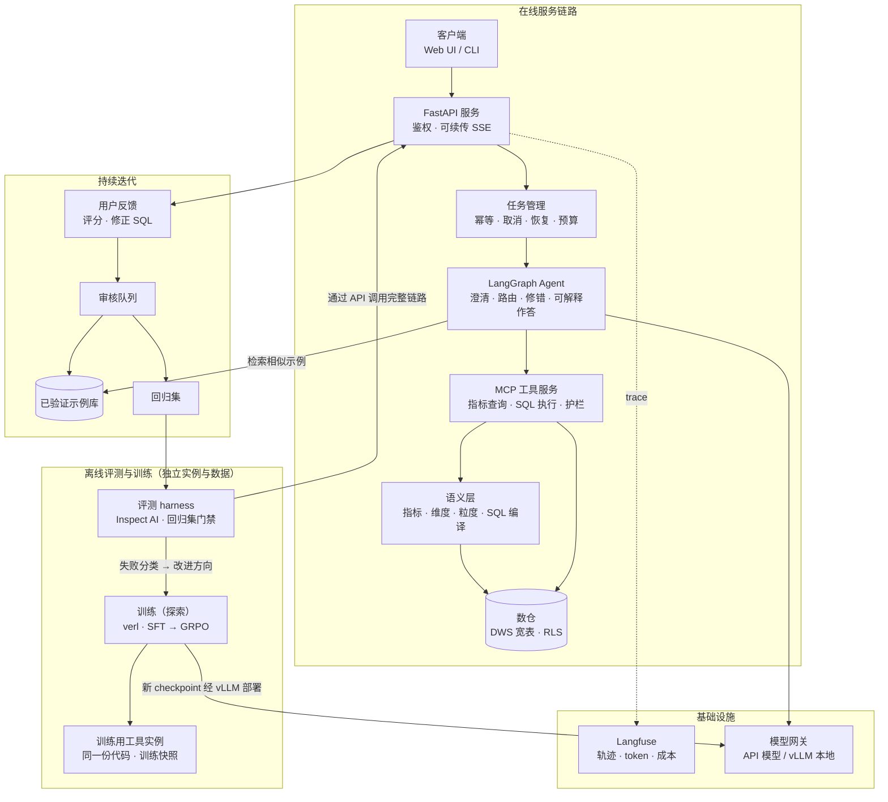

# SQL-Agent-RL

> 以评测驱动的私有化数据分析 Agent，目标是支持业务口径澄清、多轮追问与故障恢复。参照企业 ChatBI 的落地方式，以**指标语义层优先、原始 SQL 兜底**，用已验证问答示例和用户反馈持续迭代；在工程优化的基础上，再用实验检验 SFT 与强化学习能否进一步提升小模型。

**状态：** 规划中（v0.4 规格说明，开工前定稿）　**类型：** 个人项目，模拟企业 ChatBI 场景，使用公开数据集与标注明确的合成数据

**首个版本（MVP）的实现细节见 [`docs/mvp_spec.md`](docs/mvp_spec.md)。** 本文描述完整设计；MVP 只实现其中的最小闭环（§12 P0）。

---

## 目录

1. [背景与动机](#1-背景与动机)
2. [项目目标](#2-项目目标)
3. [技术亮点](#3-技术亮点)
4. [系统架构](#4-系统架构)
5. [技术栈](#5-技术栈)
6. [目录结构](#6-目录结构)
7. [模块设计](#7-模块设计)
8. [数据](#8-数据)
9. [评测方法论](#9-评测方法论)
10. [训练方案](#10-训练方案)
11. [实验计划](#11-实验计划)
12. [路线图](#12-路线图)
13. [演示案例](#13-演示案例)
14. [快速开始](#14-快速开始)
15. [结果](#15-结果)
16. [已知局限](#16-已知局限)
17. [参考资料](#17-参考资料)
18. [变更记录](#18-变更记录)

---

## 1. 背景与动机

**业务痛点。** 业务、运营、产品人员需要频繁查询数据，但大多不会写 SQL，只能向数据分析师排队提需求。"用自然语言问数据"（ChatBI）已成为大模型落地最多的场景之一。

**一次性生成 SQL 不够用。** 在真实企业数据上，单轮"表结构 + 问题 → SQL"的方案会遇到：

- **表多字段多**：需要检索相关表，并补全中间关联表；
- **字段语义含糊**：`status=3` 是什么含义、金额是否含税，需要查看样例数据才能确定；
- **业务口径不唯一**："销售额"按商品金额还是付款金额，是否包含已取消订单，取决于公司内部定义；
- **统计粒度错误**：订单级的金额关联到明细级的维度上会被重复计算，这类错误不会报错，却会给出错误的数字；
- **脏数据、SQL 方言与查询成本**。

真实的分析过程也不是一问一答：用户会先问一个问题，再追加"只看某个州""和上一季度比较"。系统必须保留已确认的口径和筛选条件。

**企业的实际做法。** 企业很少让模型直接在原始业务库上自由写 SQL。常见做法是：

- 在数仓中建设**粒度明确的主题宽表**；
- 通过**指标体系 / 语义层**统一定义口径、聚合方式、可拆分的维度，让模型负责理解需求和选择工具，由程序保证指标计算的一致性；
- 用人工确认过的**问题 → SQL 示例**与**用户反馈**持续提升准确率；
- 配合**行列级权限**、查询成本控制，以及展示口径与 SQL 的**可解释答案**，建立用户信任。

本项目按这一方式设计：**指标层能回答的问题走指标层，长尾问题在相同的约束下回退到 Agent 生成 SQL**。

**私有化部署与模型优化。** 企业数据通常不允许发送到外部 API；Agent 每个问题需要多轮模型调用。实际的私有化部署通常使用中等或较大的开源模型，依靠语义层、检索与少量 SFT；针对单一业务场景做强化学习并不常见。

因此本项目的训练部分定位为**探索性实验**：在限定的工具权限、轮数与 token 预算下，依次加入工程优化、SFT、强化学习，各自带来多少额外收益？

- SFT 可以通过包含"报错 → 修复"过程的轨迹学习恢复行为；
- RL 的潜在价值在于通过环境反馈进一步优化策略。Text-to-SQL 的执行结果可以自动验证，适合**可验证奖励（RLVR）**；
- RL 是否值得额外的算力与开发成本，**由对照实验回答，而不是预设结论**。

## 2. 项目目标

### 目标

- **G1 可用的 Agent**：指标层优先、SQL 兜底，两条路径共享同一套口径、权限与成本约束；支持口径澄清、多轮追问、SQL 报错修复；答案附口径、数据来源与 SQL；严格只读。
- **G2 可部署的工程**：异步流式 API、任务生命周期管理、行级权限、查询成本控制、有界重试与预算控制、可观测性。
- **G3 可持续迭代**：已验证问答示例库与用户反馈闭环。
- **G4 可信的评测**：按固定题目类别比较；开发集、回归集、冻结测试集分离；统计方法与数据结构匹配；用受控实验替代有选择偏差的指标。
- **G5 有依据的模型优化（探索）**：按对照链逐级验证工程优化、SFT、RL 的收益，如实报告结论。

### 非目标

- 不追求 BIRD 排行榜 SOTA；BIRD 仅作为泛化测试集。
- 不实现完整的企业级指标平台或权限平台。
- 不实现 A2A 多 Agent 协作。
- 不实现写操作，Agent 严格只读。
- 不预设"本地小模型一定更便宜"或"RL 一定有收益"。

## 3. 技术亮点

| 问题 | 技术方案 | 体现位置 |
| --- | --- | --- |
| 口径不统一、粒度错误导致重复计算 | **粒度明确的宽表 + 指标语义层**：每个指标声明聚合方式、分子分母、空值规则、可拆分维度与归属规则 | `semantic/`、`data/warehouse/` |
| SQL 回退可能绕过口径规则 | **按失败原因分类的回退策略**；两条路径共享口径、权限与成本约束 | `agent/router.py` |
| 业务口径需要澄清、追问需要修改条件 | **结构化对话状态**：按维度组织的筛选条件、显式的新增 / 替换 / 删除操作、确认后立即持久化 | `agent/context.py` |
| 用户不信任黑盒数字 | **可解释答案**：指标定义、归属规则、数据来源、过滤条件、绝对时间范围、可查看的 SQL | `agent/nodes/answer.py` |
| 不同用户可见数据范围不同 | **PostgreSQL 行级安全**：事务级身份设置、受限查询角色、函数白名单，配套针对性测试 | `infra/db/`、`mcp_server/guard.py` |
| 准确率需要持续提升 | **已验证示例检索** + **反馈审核闭环** | `examples/`、`api/feedback.py` |
| 大表上的高成本查询 | 基于**执行计划结构**的拦截规则 + 超时兜底 | `mcp_server/guard.py` |
| 协议无状态 ≠ 业务任务可恢复 | **任务生命周期管理**：幂等提交、可续传 SSE、取消、节点级恢复、有界重试与预算 | `api/tasks.py` |
| 单次准确率掩盖不稳定性 | **pass^k + 按题聚类的 bootstrap 置信区间** | `eval/reliability.py` |
| 是否需要训练、训练是否值得 | **逐级对照链**，固定题目类别，控制工具权限、轮数与 token 预算 | §11 |

## 4. 系统架构



### 数据流

1. **在线服务**：用户提问 → FastAPI 鉴权 → 任务管理创建或复用任务 → Agent 必要时先澄清口径，然后路由：
   - 问题所需的指标与维度在语义层中已定义且兼容 → `query_metric`，由语义层编译 SQL；
   - 问题不涉及任何已定义指标，且业务含义明确 → SQL 路径，在相同的口径、权限与成本约束下生成并执行 SQL；
   - 其他情况按 §7.3 的回退分类处理（澄清、说明限制或拒绝）。
2. **持续迭代**：用户评分或修正 SQL → 审核 → 通过的条目进入示例库，关键案例进入回归集。
3. **训练（探索）**：训练环境**复用同一份工具代码与护栏**，但部署为独立实例，连接训练快照数据库，不访问线上服务与线上数据。
4. **评测闭环**：评测 harness 通过 API 调用完整链路；失败分类结果决定下一步改语义层、检索、示例、提示词、工具还是模型。

### 关键设计决策

- **指标层优先，SQL 兜底，约束共享**：两条路径使用同一套口径规则、同一个受限数据库角色、同一套护栏与参考日期，避免同一问题因路径不同而得到不同口径。
- **先定义业务规则，再编译 SQL**：粒度、去重、分摊、空值规则写在语义层定义中，不留给模型临场决定。
- **权限下沉到数据库，并用测试证明**：RLS 只是一道防线，需要配合受限角色、事务级身份与函数白名单，并用测试验证其边界。
- **协议无状态与业务可恢复分开设计**。
- **先工程、后训练**。

## 5. 技术栈

| 层 | 选型 | 说明 |
| --- | --- | --- |
| 模型（训练对象） | Qwen3.5 小尺寸开源模型 | 具体档位以官方 model card 为准，开工前锁定；P0 即提供推理端点（§12） |
| 模型（教师 / 对照） | 强模型 API | SFT 轨迹采集与上限对照 |
| Agent 编排 | LangGraph | Postgres checkpointer |
| 语义层 | 自研轻量实现（YAML 定义 + sqlglot 编译） | 参考业界指标层的"指标 / 维度 / 实体"建模方式 |
| 工具协议 | MCP 2026-07-28 | 无状态请求 / 响应；锁定 SDK 版本并做兼容性测试 |
| API 服务 | FastAPI | 异步、可续传 SSE |
| 推理部署 | vLLM | OpenAI 兼容接口 |
| 数据库 | PostgreSQL（RLS、pgvector、全文检索）；SQLite（BIRD） | |
| SQL 解析 | sqlglot | 语句类型与函数白名单检查、自动 LIMIT、语义层编译 |
| 可观测 | Langfuse | 轨迹、token、成本 |
| 评测框架 | Inspect AI | |
| 训练 | verl | GRPO（GiGPO 视探测结果而定） |
| 部署 | Docker Compose | 默认单实例；`scale` profile 仅用于压测 |
| CI | GitHub Actions | 单元测试 + 回归集门禁 |
| 算力 | AutoDL 按量租用 | |

## 6. 目录结构

```
sql-agent-rl/
├── agent/
│   ├── graph.py
│   ├── state.py
│   ├── context.py              # confirmed_context 结构、更新操作、持久化
│   ├── router.py               # 路由与回退分类
│   ├── retrieval/              # 混合召回、主外键补全、示例检索
│   ├── nodes/
│   ├── skills_loader.py
│   └── prompts/
├── semantic/
│   ├── models.yaml             # 宽表：粒度、唯一键、关联关系
│   ├── metrics.yaml            # 指标：聚合、去重、分摊、分子分母、空值规则
│   ├── dimensions.yaml         # 维度：兼容指标与关联路径
│   ├── compiler.py
│   └── tests/                  # 基于小型 fixture 数据库的单元测试
├── examples/
├── mcp_server/
│   ├── server.py
│   ├── tools/
│   ├── guard.py                # 只读、函数白名单、执行计划检查、LIMIT、超时
│   ├── cache.py                # 缓存键包含用户可见范围
│   └── results.py              # 大结果摘要；result_ref 绑定任务与用户
├── api/
│   ├── main.py
│   ├── auth.py
│   ├── tasks.py
│   ├── feedback.py
│   └── deps.py
├── gateway/
├── skills/olist/
├── data/
│   ├── load_olist.py           # 原始表导入
│   ├── profile_olist.py        # 数据画像：验证唯一键、空值、状态取值、时间范围
│   ├── warehouse/              # DWS 宽表构建 SQL 与行数断言
│   ├── synthetic_tables.py
│   ├── scale_up.py
│   ├── make_snapshots.py
│   ├── build_index.py
│   └── inject_attacks.py
├── eval/
│   ├── tasks/
│   ├── datasets/               # dev / regression / frozen_test / multiturn / bird_subset / robustness / safety
│   ├── scorers/
│   ├── reliability.py
│   ├── controlled_faults/
│   ├── feedback_sim/
│   ├── snapshots/
│   ├── judge_calibration/
│   ├── loadtest/
│   └── audit/
├── train/
│   ├── sft/
│   ├── rl/
│   │   ├── env.py              # 连接独立的训练工具实例与训练快照
│   │   ├── reward.py
│   │   ├── state_probe.py
│   │   └── configs/
│   └── scripts/
├── serving/
├── infra/
│   ├── docker-compose.yml
│   ├── nginx.conf
│   └── db/
│       ├── roles.sql           # 表所有者角色与受限查询角色
│       └── rls.sql             # 行级安全策略
├── tests/
│   ├── security/               # RLS、函数白名单、连接池身份、result_ref 隔离
│   └── context/                # confirmed_context 更新规则
├── .github/workflows/
└── docs/
    ├── mvp_spec.md             # MVP 实现说明
    ├── semantic_layer.md
    ├── experiments.md
    └── pitfalls.md
```

## 7. 模块设计

### 7.1 Agent（`agent/`）

**图节点：**

| 节点 | 职责 |
| --- | --- |
| `load_context` | 读取会话的 `confirmed_context`（含版本号），按问题加载相关业务规则 |
| `clarify` | 判断是否存在影响结果的口径歧义；需要时提问，或明确声明所采用的默认口径 |
| `route` | 识别问题涉及的指标与维度，按 §7.3 决定走指标路径、SQL 路径，或澄清 / 说明限制 / 拒绝 |
| `retrieve` | 指标路径：匹配指标、维度与同义词；SQL 路径：召回表与字段、补全关联路径、检索相似示例 |
| `act` | LLM 决定下一步：调用工具、追问或给出最终答案 |
| `tools` | 执行 MCP 工具调用，回传结果摘要或错误信息（含错误码） |
| `answer` | 生成结论与口径说明；需要时生成图表 |

**控制逻辑：** `act ⇄ tools` 循环，直到给出答案或触发终止条件：最大轮数、连续相同错误上限、任务预算耗尽（§7.9）。

**结构化对话状态 `confirmed_context`：**

```python
class FilterSpec(TypedDict):
    op: Literal["in", "not_in"]
    values: list[str]

class TimeRange(TypedDict):
    expr: str                      # 用户原话，如 "上季度"
    start: date                    # 相对 REFERENCE_DATE 解析出的绝对日期（含）
    end: date                      # 不含

class ConfirmedContext(TypedDict):
    version: int                   # 每次更新 +1，答案引用所依据的版本
    metrics: list[str]             # 已确认的语义层指标 ID，如 ["category_sales"]
    rules: dict[str, str]          # SQL 路径中确认的口径假设
    filters: dict[str, FilterSpec] # 按维度 ID 组织，如 {"customer_state": {"op": "in", "values": ["SP"]}}
    time_range: TimeRange | None
    compare_to: TimeRange | None   # 对比时间段
    group_by: list[str]            # 维度 ID
    pending_questions: list[str]
```

**更新规则：** 模型输出显式的更新操作，而不是直接改写整个状态：

| 操作 | 含义 | 示例 |
| --- | --- | --- |
| `set_filter(dim, spec)` | 替换该维度的筛选条件（默认语义） | "只看圣保罗州" |
| `add_filter_values(dim, values)` | 在该维度上追加取值 | "再加上里约" |
| `remove_filter(dim)` | 删除该维度的筛选条件 | "不限州了" |
| `set_time_range(expr)` | 替换时间范围（由程序解析为绝对日期） | "改成上个月" |
| `set_compare_to(expr)` / `clear_compare` | 设置或清除对比时间段 | "和再上一季度比较" |
| `set_metrics` / `set_group_by` | 替换指标或分组维度 | |

所有操作由程序校验（维度是否存在、取值是否合法、与指标是否兼容）后再应用。

**持久化时机：** 用户回答澄清问题、或接受 Agent 声明的默认口径时，在 `/tasks/{id}/reply` 的处理中**立即写入数据库**（版本号 +1），然后才恢复执行。不在最终回答时才写回。

**参考日期：** 所有相对时间都由程序相对于固定的 `REFERENCE_DATE` 解析为绝对日期。确定规则见 `docs/mvp_spec.md`。

**可解释答案：** 指标定义与归属规则（或 SQL 路径的口径假设）、数据来源表、过滤条件、解析后的绝对时间范围、可查看的 SQL、所依据的 `confirmed_context` 版本。

### 7.2 语义层与宽表（`semantic/`、`data/warehouse/`）

**原则：先定义业务规则，再编译 SQL。** 宽表本身不能保证指标正确，每个对象都必须声明以下内容：

| 对象 | 必须声明 |
| --- | --- |
| 宽表 | 行粒度、唯一键、上游关联关系（只允许 N:1 关联，构建后用行数断言验证没有扇出） |
| 金额指标 | 聚合方式、来源字段的粒度、去重规则、是否允许按更细粒度的维度拆分（如需拆分，必须定义分摊规则） |
| 比率指标 | 分子、分母、空值处理；按分子、分母分别汇总后再相除，不对比率求平均 |
| 维度 | 兼容的指标、到指标来源表的关联路径、多值归属规则（如一笔订单包含多个类目） |

**示例：粒度问题。** Olist 的付款记录是**订单级**的，商品与类目是**订单明细级**的。"按付款金额统计各类目销售额"如果直接把订单付款金额关联到每条明细，包含多个类目的订单会被重复计算。因此：

- MVP 中的"类目销售额"定义为明细级的商品金额之和，不使用付款金额；
- "按付款金额拆分到类目"在定义分摊规则之前**不被支持**，用户提出时按"指标与维度不兼容"处理（§7.3），由 Agent 说明限制并给出可选口径。

**示例：空值问题。** 差评率定义为"**有效评分**中评分 ≤ 2 的比例"，分母只计入评分非空的评价。对于评分为 2、5、空的三条评价，结果是 1/2，而不是 1/3。

MVP 的宽表、指标与维度的完整定义见 `docs/mvp_spec.md`。

**编译器（`semantic/compiler.py`）：** 输入结构化查询（指标、维度、筛选、时间范围、对比时间段），校验兼容性后用 sqlglot 构建 SQL，返回 SQL 与结构化错误码。编译器有基于小型 fixture 数据库的单元测试，覆盖粒度、去重、空值与归属规则。

### 7.3 路由与回退分类（`agent/router.py`）

"语义层不能回答"需要按原因分类，否则 SQL 回退会绕过语义层要保证的规则。

| 情况 | 错误码 | 行为 |
| --- | --- | --- |
| 问题不涉及任何已定义指标，业务含义明确 | `NOT_COVERED` | 允许走 SQL 路径，沿用已确认的口径规则 |
| 涉及已定义指标，但请求的维度或拆分方式不兼容 | `INCOMPATIBLE` | **不回退到 SQL**；向用户说明限制，提供兼容的替代口径或请求澄清 |
| 口径存在歧义 | `AMBIGUOUS` | 澄清 |
| 权限不足 | `PERMISSION_DENIED` | 拒绝，**不能通过 SQL 回退绕过** |
| 成本检查拒绝 | `COST_REJECTED` | 建议缩小范围；改写后仍受同样的限制 |
| 编译器自身出错 | `COMPILER_ERROR` | 记录故障并告知用户，**不把内部错误伪装成正常回退** |

**两条路径共享的约束：** 同一个受限数据库角色与 RLS 身份、同一套护栏、同一个参考日期，以及当前 `confirmed_context` 中已确认的口径。

### 7.4 MCP 工具与护栏（`mcp_server/`）

| 工具 | 说明 |
| --- | --- |
| `list_metrics` | 指标、维度、定义与兼容关系 |
| `query_metric` | 结构化指标查询；返回结果摘要、`result_ref`、编译后的 SQL 或错误码 |
| `list_tables` / `describe_table` / `sample_rows` | schema 探查（仅限查询角色可见的 DWS 层表） |
| `search_schema` | 混合召回 + 主外键补全（P1） |
| `run_sql` | 经护栏检查后执行；返回结果摘要、`result_ref` 或错误码 |
| `get_result` | 分页取回结果；`result_ref` 绑定任务与用户，只能取回本人本任务的结果 |
| `plot` | 结构化 `chart_spec` 经 schema 校验后渲染，不执行任意代码 |

**护栏（`guard.py`）：**

1. 只读账号；
2. sqlglot 解析，仅允许单条 SELECT；
3. **函数白名单**：只允许聚合、日期、字符串、条件等常用函数；禁止 `set_config` 等可修改会话参数的函数，以及系统管理类函数；
4. 自动追加 LIMIT；语句超时；
5. **执行计划检查（P1）**：执行前用 EXPLAIN 查看计划结构，拦截例如"在标记为大表的事实表上做无时间条件的全表扫描"这类模式。EXPLAIN 的 `cost` 是规划器的估算单位，不代表耗时；`rows` 是节点的预计输出行数，不等于扫描行数。因此该检查只作为启发式拦截，**最终由语句超时兜底**，不承诺准确预测查询耗时；
6. 返回内容中的敏感字段脱敏；数据库内容一律视为数据而非指令。

**部署：** 遵循 MCP 2026-07-28 无状态规范；默认单实例，`scale` profile 下多实例 + Nginx 仅用于压测。

### 7.5 权限（`api/auth.py`、`infra/db/`）

**会话与库级：** 服务端校验用户对 `db_id` 的访问权限与会话归属。

**行级（PostgreSQL RLS）：** RLS 只是其中一道防线，PostgreSQL 的超级用户、带 `BYPASSRLS` 属性的角色会绕过 RLS，表所有者默认也不受约束。因此：

- 表由单独的所有者角色持有；应用使用的查询角色**不是超级用户、不是表所有者、没有 `BYPASSRLS`**，并对相关表启用 `FORCE ROW LEVEL SECURITY`；
- 查询角色只被授予 DWS 层表的访问权限，不能访问原始表；如使用视图，视图以调用者身份执行，使 RLS 对视图同样生效；
- 每个请求在事务内用 `SET LOCAL` 设置用户的可见范围，事务结束后自动失效，避免连接池复用时遗留上一个用户的身份；
- 护栏的函数白名单禁止生成的 SQL 修改该会话参数；
- `result_ref`、缓存与示例库按用户可见范围隔离（缓存键包含可见范围）。

**验证方式：** 不做"越权数据一定不会返回"的承诺，而是用一组针对性测试证明上述每一条（测试清单见 `docs/mvp_spec.md`），并在安全评测中统计结果。

### 7.6 已验证示例库与反馈闭环（`examples/`、`api/feedback.py`）

- 每条示例包含问题、指标查询或 SQL、来源（人工种子 / 用户反馈）、审核人与时间；
- 入库时与**冻结测试集**做相似度去重，冻结测试集的题目永不进入示例库；
- 反馈中的修正 SQL 必须经过审核（执行并核对结果）才能入库；
- 指标层缺失的口径记录为语义层待新增项。

### 7.7 Schema 检索（`agent/retrieval/`，P1）

关键词 + 向量混合召回 → 主外键关联补全 → 业务定义检索 → 重排序（按需）。度量表召回率、关键字段召回率，以及对最终准确率的贡献。

### 7.8 Skills（`skills/`）

高频口径优先沉淀到语义层；`skills/` 只保留语义层未覆盖的业务规则与踩坑笔记，按需加载。

### 7.9 任务生命周期与故障恢复（`api/tasks.py`）

| 场景 | 行为 |
| --- | --- |
| 重复提交 | `Idempotency-Key`；同一 key 返回已有任务 |
| SSE 断开 | 任务继续执行；客户端用 `Last-Event-ID` 重连续传 |
| 用户取消 | 在下一个节点边界停止，状态记为 `cancelled` |
| 进程崩溃 | 从最后一个已写入 checkpoint 的节点之后恢复（见下方语义说明） |
| 工具超时、模型限流 | 有界重试 + 指数退避，计入任务预算 |
| 预算耗尽 | 最大 token、最大工具调用次数、最大墙钟时间；超出后返回部分结果并说明原因 |

**恢复语义：** checkpoint 在每个节点完成后写入，因此恢复的保证是**以节点为粒度的至少一次执行**。如果某个节点内的模型调用已经完成、但 checkpoint 尚未写入时进程崩溃，恢复后该节点会重新执行，产生一次额外的模型调用与费用。工具均为只读，重复执行不会产生副作用。项目通过 Langfuse 记录每次调用，统计故障演练中的重复调用次数，如实报告这一窗口的影响。

**任务状态：** `queued → running → (waiting_user) → succeeded | failed | cancelled`。

### 7.10 API（`api/`）

| 方法 | 路径 | 说明 | 阶段 |
| --- | --- | --- | --- |
| POST | `/tasks` | 创建任务 | P0（`Idempotency-Key` 为 P1） |
| GET | `/tasks/{id}` | 状态与结果（含口径说明与 SQL） | P0 |
| GET | `/tasks/{id}/events` | SSE 事件流 | P0（`Last-Event-ID` 续传为 P1） |
| POST | `/tasks/{id}/reply` | 回复澄清问题；立即持久化确认内容 | P0 |
| POST | `/tasks/{id}/cancel` | 取消任务 | P1 |
| POST | `/tasks/{id}/feedback` | 评分、修正 SQL 或说明 | P1 |
| GET | `/sessions/{id}` | 会话历史与 `confirmed_context` | P0 |
| GET / POST | `/review/...` | 审核队列 | P1 |
| GET | `/health` | 健康检查 | P0 |

### 7.11 模型网关（`gateway/`）

OpenAI 兼容接口，在 API 模型与本地 vLLM 模型之间切换；处理限流退避；记录 token、延迟与费用。

## 8. 数据

### 8.1 业务数据库：Olist

[Brazilian E-Commerce Public Dataset by Olist](https://www.kaggle.com/datasets/olistbr/brazilian-ecommerce)：巴西电商平台的真实脱敏数据，约 10 万笔订单，包含订单、订单明细、支付、评价、商品、卖家、客户、地理位置等关联表。导入后先做**数据画像**（唯一键、空值、取值分布、时间范围），用画像结果确认宽表设计中的假设。

### 8.2 合成数据（均明确标注）

- **同领域干扰表**（P1）：退款表、日汇总表、商品快照表等，测试找表与粒度判断；
- **规模扩充**（P1，可选）：扩充到千万行级别，仅用于性能与护栏测试，不用于准确率评测。

### 8.3 数据集划分

| 数据集 | 用途 | 规则 |
| --- | --- | --- |
| `dev` | 调提示词、检索、路由与规则 | 可以反复查看失败案例 |
| `regression` | 检查已修复问题是否再次失败 | 可包含反馈修正案例；**只能证明修复被保留，不能证明泛化** |
| `frozen_test` | 衡量最终效果 | P0 结束时编写并冻结；只在里程碑运行；不用失败案例调参；不进入示例库与训练 |
| `multiturn` | 澄清、追问、条件修改 | 同样划分开发与冻结两部分 |
| `bird_subset` | 泛化测试 | 仅 SQL 路径 |
| `bird_train` | SFT / RL 训练数据来源 | P2 起使用 |
| `robustness` / `safety` | 鲁棒性与安全 | P1 |
| `feedback_stream` | 反馈闭环模拟 | P1 |

### 8.4 题目类别（事先固定）

每道题在编写时就标注类别，所有配置都在同一批题上按类别比较：

| 类别 | 期望行为 |
| --- | --- |
| `metric_covered` | 语义层可以回答，期望走指标路径 |
| `long_tail_sql` | 不涉及已定义指标，期望走 SQL 路径 |
| `must_clarify` | 存在影响结果的口径歧义，期望先澄清（或明确声明默认口径） |
| `unsupported` | 指标与维度不兼容、超出数据范围或权限不足，期望说明限制或拒绝 |

### 8.5 `multiturn` 示例

```
用户：上季度哪个类目的销售额下降最多？
Agent：销售额默认按商品金额统计（不含运费，不含已取消和不可用的订单）。
      按付款金额拆分到类目目前不支持，因为付款记录是订单级的。是否按商品金额统计？
用户：可以。
Agent：[返回结果，附口径说明与 SQL]
用户：只看圣保罗州，和再上一季度比较。
Agent：[执行 set_filter(customer_state, SP)、set_compare_to(再上一季度)，返回结果]
```

评分包括：是否恰当澄清、`confirmed_context` 的更新是否正确、每轮结果是否正确、口径说明是否与实际执行一致。

## 9. 评测方法论

### 9.1 指标体系

| 层 | 指标 |
| --- | --- |
| 结果层 | 按题目类别统计的执行准确率；快照差分准确率（P2）；judge 正确率（P2，校准后） |
| 路由层 | 路由正确率与路由错误分布（如"应走指标层却走了 SQL"） |
| 行为层 | `must_clarify` 题的澄清率；`unsupported` 题的正确拒绝率；`confirmed_context` 更新正确率 |
| 轨迹层 | 表召回率、关键字段召回率、工具调用有效率、平均轮数 |
| 恢复能力 | 受控故障注入下的恢复率 |
| 可靠性层 | pass^k（k=5） |
| 可解释性 | 口径说明与实际执行 SQL 的一致率 |
| 成本层 | 每个成功任务的成本、token 数、延迟 P50 / P95 |

**不按"实际走了哪条路径"统计准确率**：不同配置会把不同难度的题路由到不同路径，按实际路径统计会产生选择偏差。

### 9.2 可靠性：pass^k

```
pass^k = mean_over_tasks[ C(c, k) / C(n, k) ]
```

### 9.3 统计方法

- pass^k 及所有跨题聚合指标：按题目做聚类 bootstrap；
- 每题只运行一次的通过率：可使用 Wilson 区间；
- 配置对比：按题目做配对 bootstrap，报告差值的置信区间；
- 记录随机种子、模型、prompt、语义层、示例库版本、解码参数与预算上限。

### 9.4 降低执行准确率的盲点（P2）

多快照差分检验、边界数据、业务规则检查；训练与评测使用不同快照。

### 9.5 受控故障注入（P1）

相同题目、相同位置注入相同故障，比较恢复率。

### 9.6 评测器校准与基准审计（P2）

Judge 与人工标注的 Cohen's kappa（≥ 0.6 可用，≥ 0.8 强）；审计结论只代表抽样子集。

### 9.7 安全评测（P1）

分别统计**模型接受了恶意指令**与**最终操作被底层权限拦截**：数据中的提示注入、行级越权、库表越权、诱导错误口径、篡改参数、试图通过函数修改会话身份、高成本查询。

### 9.8 工程验证（P1）

并发压测（`scale` profile）；故障演练（SSE 重连、取消、强杀恢复、重复提交），并统计恢复过程中的重复模型调用次数。

### 9.9 回归门禁

关键案例不得失败；新增失败数不超过上限（初始为 1）；安全集中"最终操作被执行"的次数为 0；语义层与安全单元测试全部通过。

### 9.10 成本核算

本地方案计入 GPU 租用、利用率、失败与重试；单独列出训练成本；统一按每个成功任务的成本比较。

## 10. 训练方案

### 10.1 定位与前置条件

训练部分是**探索性实验**，用于回答"在限定预算下，训练能否让小模型在长尾 SQL 题上逼近强模型"，并展示训练流程与实验设计能力。只有当对照链显示工程优化后，`long_tail_sql` 类题目仍存在明显的、可归因于模型能力的失败时，才进入训练阶段。

### 10.2 SFT

用强模型 API 在 `bird_train`（及与评测集去重后的 Olist 训练题）上采集多轮轨迹；只保留结果正确的轨迹，并有意保留"报错 → 修复"类轨迹。

### 10.3 RL 环境

`train/rl/env.py` 复用工具服务的**同一份代码与护栏**，但连接独立部署的训练工具实例与训练快照数据库，不访问线上服务与数据。

### 10.4 奖励设计

```
r = 1[训练快照上执行结果匹配]
  + α · 1[格式合规]
  − β · max(0, 轮数 − T)
  − γ · 无效工具调用次数
```

重点监控：空结果钻空子、大量重复尝试、格式崩坏。

### 10.5 算法

GRPO 作为基线。GiGPO 依赖跨轨迹识别相同的环境状态，先用 `state_probe.py` 统计中间状态重复率与分组规模，满足条件才做完整实验，否则如实记录。

### 10.6 公平比较与算力

对齐并记录 rollout token、环境调用次数与 GPU 小时。算力在 AutoDL 按阶段租用：开发阶段无卡，基线与部署用单张 24GB 卡，SFT 与 RL 调试用单张 80GB 卡，正式 RL 实验视模型尺寸用 1–4 张 80GB 卡。

## 11. 实验计划

### 11.1 对照链（主实验）

所有配置在 `frozen_test` 上运行，控制相同的工具权限、最大轮数与 token 预算。

| 步骤 | 对照 | 要回答的问题 |
| --- | --- | --- |
| 1 | 同一小模型：单轮 Text-to-SQL → 多轮 Agent | 多轮工具调用是否必要？ |
| 2 | → + 语义层 | 语义层能解决多少问题？ |
| 3 | → + 检索、示例库、上下文管理 | 工程优化能解决多少长尾问题？ |
| 4 | → + SFT | 训练是否带来额外收益？ |
| 5 | → + RL（GRPO） | RL 是否值得额外成本？ |
| 6 | 最佳方案 vs 强模型 Agent | 与强模型的差距在哪里？ |

| 配置 | metric_covered | long_tail_sql | must_clarify | unsupported | 路由错误率 | pass^5 | 成功任务成本 | P95 延迟 |
| --- | --- | --- | --- | --- | --- | --- | --- | --- |
| 小模型 单轮 | | | | | | | | |
| 小模型 Agent | | | | | | | | |
| + 语义层 | | | | | | | | |
| + 检索 / 示例 / 上下文 | | | | | | | | |
| + SFT | | | | | | | | |
| + SFT + GRPO | | | | | | | | |
| 强模型 Agent | | | | | | | | |

### 11.2 专项实验

1. **NL2Metric vs NL2SQL**：在 `metric_covered` 题上比较走指标层与直接写 SQL 的准确率与 pass^k；
2. **示例库规模**对 `long_tail_sql` 准确率的影响；
3. **反馈闭环模拟**：用标准答案模拟正确的用户修正，在 `frozen_test` 上观察准确率随反馈积累的变化。结论表述为"**在反馈正确的条件下的收益**"，不等同于真实用户反馈的效果；
4. **检索**各环节的贡献；
5. **上下文管理**对多轮任务的影响；
6. **执行计划检查**（扩充数据上）对高成本查询的拦截效果；
7. **奖励组成**消融；
8. **GiGPO 探测**。

## 12. 路线图

### P0：MVP（最小完整闭环）

范围：2 张宽表 + 1 张桥接表、2 个指标、2 个维度（外加时间）、两条查询路径、一小组单轮与多轮评测题。详见 `docs/mvp_spec.md`。

- [ ] Olist 导入与数据画像，确定 `REFERENCE_DATE`
- [ ] DWS 宽表与行数断言
- [ ] 语义层：模型、指标、维度定义；编译器与 fixture 单元测试
- [ ] MCP 工具：`list_metrics`、`query_metric`、`describe_table`、`run_sql`，护栏（只读、单条 SELECT、函数白名单、LIMIT、超时）
- [ ] Agent：澄清、路由与回退分类、`confirmed_context` 更新与持久化、修错循环、可解释答案
- [ ] FastAPI：`/tasks`、`/events`（SSE）、`/reply`、`/sessions`
- [ ] **小模型推理端点**：托管 API 调用同一开源小模型，或在单张 24GB 卡上用 vLLM 部署
- [ ] Langfuse 基础追踪
- [ ] `dev` 约 20 题、`multiturn` 约 5 组；编写并冻结 `frozen_test`
- [ ] 对照链步骤 1–2

### P1：Agent 开发岗的主要支撑

- [ ] 检索：混合召回、主外键补全
- [ ] 示例库与反馈闭环、反馈模拟实验
- [ ] RLS 行级权限与安全测试
- [ ] 执行计划检查；可选的规模扩充
- [ ] 任务生命周期：幂等、`Last-Event-ID` 续传、取消、恢复、有界重试、预算
- [ ] 上下文管理与缓存
- [ ] 合成干扰表；扩大评测集；`robustness`、`safety`、`regression`；受控故障注入
- [ ] pass^k 与聚类 bootstrap
- [ ] Docker Compose 部署、压测、CI 门禁
- [ ] 对照链步骤 3，专项实验 1–6

### P2：模型适配与评测深化

- [ ] 小模型完整评测；SFT
- [ ] 成本核算
- [ ] 多快照差分检验、judge 校准、基准审计
- [ ] 对照链步骤 4、6

### P3：训练探索

- [ ] RL 环境（独立实例与训练快照）与奖励函数；最小尺寸模型跑通
- [ ] GRPO 正式实验，对照链步骤 5
- [ ] GiGPO 状态探测

## 13. 演示案例

| 案例 | 阶段 | 内容 |
| --- | --- | --- |
| 口径澄清与条件修改 | P0 | 用户提出含糊的指标，Agent 澄清并说明不支持的口径；追问时正确修改筛选条件与对比时间段 |
| 长尾 SQL 与报错恢复 | P0 | 不涉及已定义指标的问题走 SQL 路径，执行报错后根据错误信息修复 |
| 行级权限 | P1 | 区域经理询问全国数据，结果只包含其有权查看的范围；尝试修改会话身份的 SQL 被拒绝 |
| 故障中断恢复 | P1 | 任务执行中强杀进程，重启后从 checkpoint 恢复，并展示重复调用次数 |
| 反馈闭环 | P1 | 用户修正一条错误 SQL，审核通过后相似问题回答正确 |

每个案例都可以通过脚本复现，并附 Langfuse 轨迹截图。

## 14. 快速开始

> 以下为规划中的使用方式，将随实现更新。

```bash
git clone https://github.com/<your-name>/sql-agent-rl.git
cd sql-agent-rl
cp .env.example .env            # API Key、数据库连接、模型端点等

python data/load_olist.py
python data/profile_olist.py    # 输出数据画像与建议的 REFERENCE_DATE
psql -f data/warehouse/build.sql

docker compose -f infra/docker-compose.yml up -d

curl -X POST http://localhost:8000/tasks \
  -H "Content-Type: application/json" \
  -d '{"question": "上个季度哪个类目的销售额最高？", "db_id": "olist"}'

curl -N http://localhost:8000/tasks/<task_id>/events

pytest semantic/tests tests/
inspect eval eval/tasks/dev.py --model <model-name>
```

## 15. 结果

> 待实验完成后填写。所有数字均来自 `frozen_test` 上的实际运行，附置信区间、预算上限与实验配置。

## 16. 已知局限

- 自建评测集规模有限，所有对比都附置信区间；
- Olist 的数据规模与复杂度低于真实企业数仓；
- 语义层为自研轻量实现，覆盖的指标与维度有限；
- 反馈闭环实验使用模拟的正确反馈，不代表真实用户反馈的效果；
- 题目、指标定义与标准答案由作者本人编写，可能带有个人偏差；冻结测试集虽然与开发过程隔离，但出题人与开发者为同一人；
- 节点级恢复存在"调用已完成、checkpoint 未写入"的窗口，可能产生一次重复模型调用；
- 权限设计通过测试验证，不构成完整的安全保证；
- 训练实验仅在小尺寸模型上进行，属于探索性质。

## 17. 参考资料

- MCP 规范 2026-07-28：https://modelcontextprotocol.io/specification/2026-07-28
- LangGraph：https://github.com/langchain-ai/langgraph
- verl：https://github.com/verl-project/verl
- verl-agent（GiGPO）：https://github.com/langfengQ/verl-agent
- Inspect AI：https://github.com/UKGovernmentBEIS/inspect_ai
- Langfuse：https://github.com/langfuse/langfuse
- PostgreSQL 行级安全：https://www.postgresql.org/docs/current/ddl-rowsecurity.html
- PostgreSQL EXPLAIN：https://www.postgresql.org/docs/current/using-explain.html
- BIRD：https://bird-bench.github.io/
- Olist 数据集：https://www.kaggle.com/datasets/olistbr/brazilian-ecommerce
- τ-bench（pass^k）：https://github.com/sierra-research/tau-bench
- ChatBI: Towards Natural Language to Complex Business Intelligence SQL：https://arxiv.org/abs/2405.00527
- FLEX（NAACL 2025）：https://arxiv.org/abs/2409.19014
- Text-to-SQL Benchmarks are Broken: An In-Depth Analysis of Annotation Errors（CIDR 2026）

## 18. 变更记录

### v0.4（开工前定稿）

- **语义层规则**：宽表声明行粒度、唯一键与关联关系，构建后用行数断言验证；指标声明聚合、去重、分摊、分子分母与空值规则；维度声明兼容指标与多值归属规则。修正类目销售额的粒度问题（改为明细级商品金额，付款金额拆分到类目在定义分摊规则前不支持）与差评率的空值问题。
- **回退分类**：按 `NOT_COVERED`、`INCOMPATIBLE`、`AMBIGUOUS`、`PERMISSION_DENIED`、`COST_REJECTED`、`COMPILER_ERROR` 区分处理；两条路径共享口径、权限与成本约束。
- **权限**：明确 RLS 的边界（超级用户、表所有者、`BYPASSRLS`）；受限查询角色、`FORCE ROW LEVEL SECURITY`、`SET LOCAL`、函数白名单、`result_ref` 与缓存隔离；删除"越权数据一定不会返回"的承诺，改为测试验证。
- **评测**：按事先固定的题目类别比较，路由错误单独报告；划分 `dev`、`regression`、`frozen_test`；反馈模拟结论限定为"反馈正确条件下的收益"。
- **对话状态**：`confirmed_context` 改为按维度组织的结构化筛选条件与绝对时间范围，定义显式更新操作；确认后立即持久化并记录版本号。
- **恢复语义**：改为"以节点为粒度的至少一次执行"，说明调用完成与 checkpoint 写入之间的窗口。
- **训练隔离**：训练环境复用同一份代码，但使用独立实例与训练快照。
- **其他修正**：EXPLAIN 的 cost 与 rows 含义；P0 即提供小模型推理端点；开头改为目标式表述。
- **范围收敛**：P0 收敛为 MVP 最小闭环，新增 `docs/mvp_spec.md`。

### v0.3

- 新增轻量指标语义层与主题宽表、已验证示例库与反馈闭环、PostgreSQL RLS、执行计划检查、可解释答案；明确训练为探索性实验；MCP 默认单实例。

### v0.2

- 定位调整；修正 SFT 表述与 pass^k 置信区间；新增多轮对话、任务生命周期、受控故障注入等；GiGPO 改为先做状态探测；路线图改为 P0–P3。

### v0.1

- 初始规格说明。
